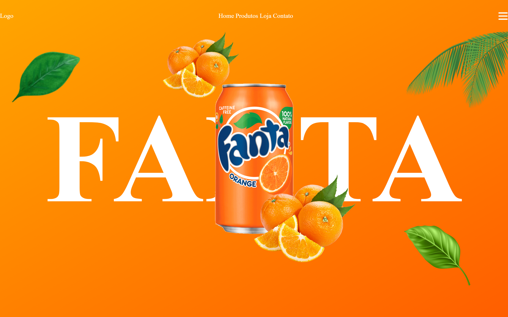

# Projeto Fanta

**Landing page inspirada na Fanta** · HTML · CSS · JavaScript

[](LICENSE)

Landing page moderna e responsiva inspirada na identidade visual da Fanta, com design vibrante e foco na experiência do usuário.



## Sobre o projeto

Exercício de estilização e composição visual, sem framework, focado em reproduzir a identidade de marca da Fanta numa página só.

## Stack

- **HTML5**
- **CSS3**
- **JavaScript**

## Como rodar

Os caminhos das imagens são absolutos, então a página precisa ser servida por um servidor local (não funciona abrindo o arquivo direto no navegador):

```bash
git clone https://github.com/joaobatis1a/projeto-fanta.git
cd projeto-fanta
python3 -m http.server 8000
```

Acesse `http://localhost:8000`.

## Autor

**João Batista da Silva Neto**

- GitHub: [@joaobatis1a](https://github.com/joaobatis1a)
- LinkedIn: [joao-batista-silva-neto](https://linkedin.com/in/joao-batista-silva-neto)
- E-mail: [profissionalba1is1a@gmail.com](mailto:profissionalba1is1a@gmail.com)

## Licença

Distribuído sob a licença MIT. Veja [`LICENSE`](LICENSE) para mais detalhes.
